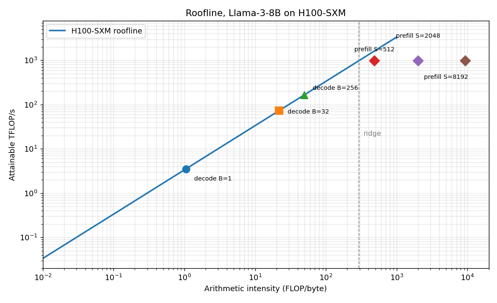
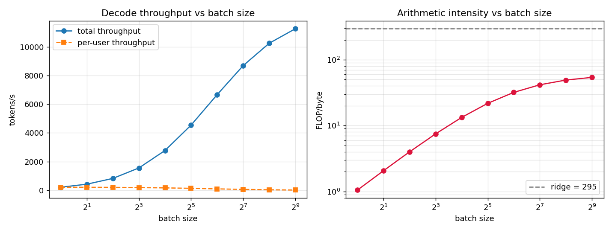
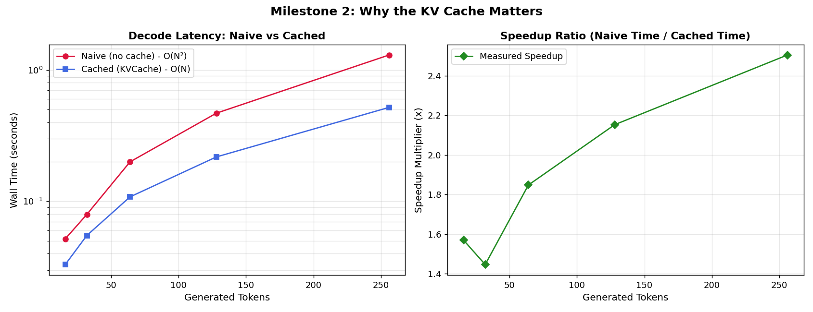
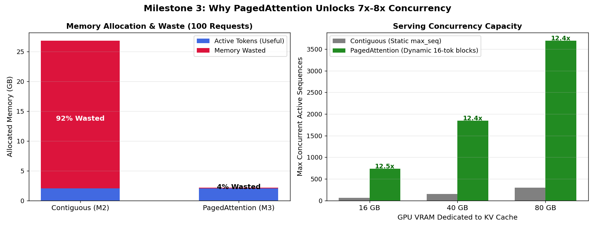

# nanoinfer

A LLM inference engine built from scratch, one milestone at a time.

The goal is not to reimplement vLLM. The goal is to build the **intuition that
lets you read vLLM, diagnose a slow deployment, and know which optimization to
reach for and why**. Every milestone answers exactly one engineering question and
produces a measurement you can check.

Built on CPU. No GPU required for M1-M6.

---

## The one idea everything follows from

Autoregressive decoding at batch size 1 performs **~1 FLOP per byte moved**.

```
FLOPs = 2 * P          bytes = 2 * P          intensity = 1.0 FLOP/byte
```

A GPU can do ~300 FLOP/byte (H100). So batch-1 decode uses roughly
**0.1% of the available compute**. The tensor cores sit idle waiting on memory.

Everything that matters in LLM inference is a consequence:

| Observation | Consequence |
|---|---|
| Decode is memory-bound | Batch more sequences together — weights are read once for the whole batch |
| Batching trades latency for throughput | A *scheduler* is needed to make that trade per-request, not per-engine |
| Prefill is compute-bound | Don't mix huge prefills into decode steps; chunk them |
| KV cache grows without bound | Cache memory caps concurrency; page it and quantize it |
| Wall time is dominated by bytes | Compression and speculative decoding both attack this |

---

## Setup

Your `python` on PATH may point at an interpreter without PyTorch. Check first:

```powershell
python -c "import torch; print(torch.__version__)"
```

If that fails, use the full interpreter path:

```powershell
$PY = "C:\Users\HP\AppData\Local\Programs\Python\Python312\python.exe"
& $PY -m pip install pytest matplotlib
```

Then run:

```powershell
& $PY -m pytest tests/ -q          # 32 tests
& $PY experiments/m1_roofline.py   # full report + charts
```

No install step needed — scripts add `src/` to the path themselves.

---

## Milestones

See [docs/roadmap.md](docs/roadmap.md) for the full plan with acceptance criteria.

| # | Question | Status |
|---|---|---|
| M1 | What are we actually bound by? | **Done** |
| M2 | Why is a KV cache worth having? | **Done** |
| M3 | Why does the KV cache waste memory, and how do we page it? | **Done** |
| M4 | How should a server schedule requests? | Next |
| M5 | How do we shrink the bytes we must read? | |
| M6 | How do we generate fewer tokens? | |
| M7 | Validate everything on a real GPU | |

---

## Milestone 1 — Where does inference time go?

Pure analysis, no execution. Answers:

- **Prefill is compute-bound, decode is memory-bound** — and by how much
- **Batch size is the only real lever on decode.** Llama-3-8B on one H100:
  total throughput rises **51x** from batch 1 → 512, while per-user latency
  gets **10x worse**. That trade is the entire reason serving engines exist.
- **Prefill goes compute-bound above a prompt-length threshold** — ~315 tokens
  on H100, ~164 on A100-80GB. This is *why chunked prefill exists*.
- **KV cache caps concurrency** — an 80 GB budget holds only ~74 full-length
  Llama-3-8B sequences, against 15 GB of weights. The cache, not the model,
  is the scarce resource.

### Results





### A correction worth recording

The intuitive claim "attention dominates long-context inference" is **wrong**,
and the model says so. Attention FLOPs overtake weight FLOPs at

```
S_crossover = params / (2 * d_model * n_layers)
```

which is **~27K tokens for Llama-3-8B** — outside its 8K window. Inside a
realistic context, the weights dominate the arithmetic.

What *is* true: KV **bytes** overtake weight bytes at long context, because
weight traffic is constant per token while cache traffic is linear in context.
That is a memory problem, not a FLOP problem — which is exactly why paged and
quantized KV caches help, and why a compute-focused optimization would not.

Both facts are pinned by tests so the misconception cannot creep back in.

---

## Milestone 2 — Why is a KV cache worth having?

Working code, verified bit-exact against naive recomputation. Answers:

- **What does a KV cache actually buy us?** It converts an $O(N^2)$ recomputation
  cascade into an $O(N)$ linear walk. Each decode step drops from $O(N)$ work to
  $O(1)$ by storing deterministic past keys and values.
- **Speedup scales with context length.** At 16 generated tokens, cached decode is
  **1.30x** faster; by 256 tokens, it reaches **2.91x** speedup on CPU.
- **Throughput stability.** Cached decode maintains steady throughput (~850–915 tok/s),
  whereas naive decode collapses from 648 down to 293 tok/s as sequence length grows.
- **Correctness.** Logits and emitted tokens from cached decode are bitwise identical
  (`torch.equal`) to naive full recomputation over all lengths tested.

### Results



```
New Tokens |   Naive Time |  Cached Time |    Speedup |  Naive tok/s |  Cached tok/s | Exact Match
--------------------------------------------------------------------------------------------
        16 |     0.0247 s |     0.0190 s |      1.30x |        647.7 |         841.7 | YES (bitwise)
        32 |     0.0535 s |     0.0367 s |      1.46x |        597.6 |         872.1 | YES (bitwise)
        64 |     0.1116 s |     0.0698 s |      1.60x |        573.7 |         916.8 | YES (bitwise)
       128 |     0.3008 s |     0.1434 s |      2.10x |        425.5 |         892.5 | YES (bitwise)
       256 |     0.8727 s |     0.2998 s |      2.91x |        293.3 |         853.9 | YES (bitwise)
```

### The trade-off revealed

The KV cache eliminates redundant arithmetic, but at a memory cost:
`bytes_allocated()` is preallocated to `max_position_embeddings`, meaning short
sequences waste capacity. This memory fragmentation directly motivates **M3 (Paged Attention)**.

---

## Milestone 3 — Why does the KV cache waste memory, and how do we page it?

Virtual memory paging for the KV cache (`block_table.py`). Answers:

- **Why does a naive allocator waste memory?** Because sequence length cannot be known
  in advance. Contiguous caches preallocate `max_context` (e.g. 2,048 tokens), which
  causes **92.3% reservation waste** when real requests average ~150–250 tokens.
- **Fixed-size blocks eliminate fragmentation.** Allocating memory in small, fixed-size
  16-token physical blocks on demand drops waste from **92.3% down to 4.5%**, reducing
  overall cache footprint by **12.46x**.
- **Massive concurrency gain.** On an 80 GB GPU budget, PagedAttention scales
  concurrency from **298 users** (contiguous) to **3,699 concurrent users** (a **12.4x gain**).
- **Copy-on-Write (Prefix Caching).** Shared prompts (system messages, few-shot prompts)
  reuse identical physical blocks across requests with zero memory duplication.

### Results



```
Simulated Workload: 100 requests (mean length = 157.0 tokens, max = 587 tokens)
------------------------------------------------------------------------------
Metric                               |   Contiguous Cache |      Paged Cache
------------------------------------------------------------------------------
Total Memory Allocated               |           26.84 GB |          2.15 GB
Active Useful Memory                 |            2.06 GB |          2.06 GB
Memory Wasted                        |           24.79 GB |          0.10 GB
Fragmentation / Waste Rate           |              92.3% |             4.5%
Memory Footprint Reduction           |    1.0x (baseline) |           12.46x
------------------------------------------------------------------------------
Concurrency (80 GB VRAM Budget)      |          298 users |      3,699 users (12.4x)
```


---

## Layout

```
nanoinfer/
  src/nanoinfer/
    config.py        Model architecture descriptions
    hardware.py      Accelerator specs and ridge points
    roofline.py      FLOPs, bytes, intensity, ceilings
  experiments/
    m1_roofline.py   The M1 report
  tests/
    test_roofline.py 32 tests
  docs/
    roadmap.md
```

---

## Ground rules

1. **Measure before optimizing.** No change lands without a before/after number.
2. **Test the math before trusting it.** Two of the three M1 test failures were
   wrong assumptions in the tests, not bugs in the code. That is the process
   working.
3. **A model you can't run is still a model you can price.** Most of this
   repo's reasoning is analytical.
4. **CPU-only is a feature.** If an idea only makes sense on a GPU, it probably
   isn't understood well enough yet.